# Line agent vs graph agent: 14 differences, with Claude Code examples

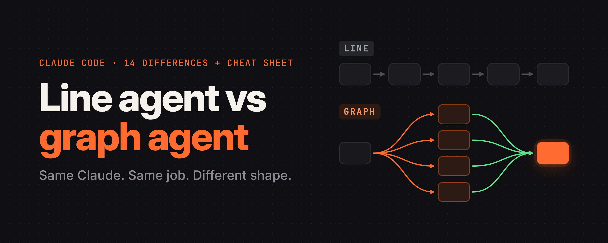

A Claude agent that works in a line is not the same as a Claude agent that works like a graph.

Let me explain.....

A line agent does one thing at a time.

Step one. Wait. Step two. Wait. Step three.

Give it 9 big files and it reads them one by one, all in the same head.

By file 7 its context is full, and it starts to forget why it opened file 1.

If it crashes on file 4, files 5 to 9 never get read.

A graph agent gets the same 9 files.

Before it starts, it asks one question: "Does file 2 need anything from file 1?"

No? Then nobody waits.

It sends 9 subagents at once. Each one gets one file and a clean head.

(A subagent is a helper that Claude starts with its own fresh context.)

Only the answers come back. Then one last subagent puts them together.

Same Claude. Same job. Different shape.

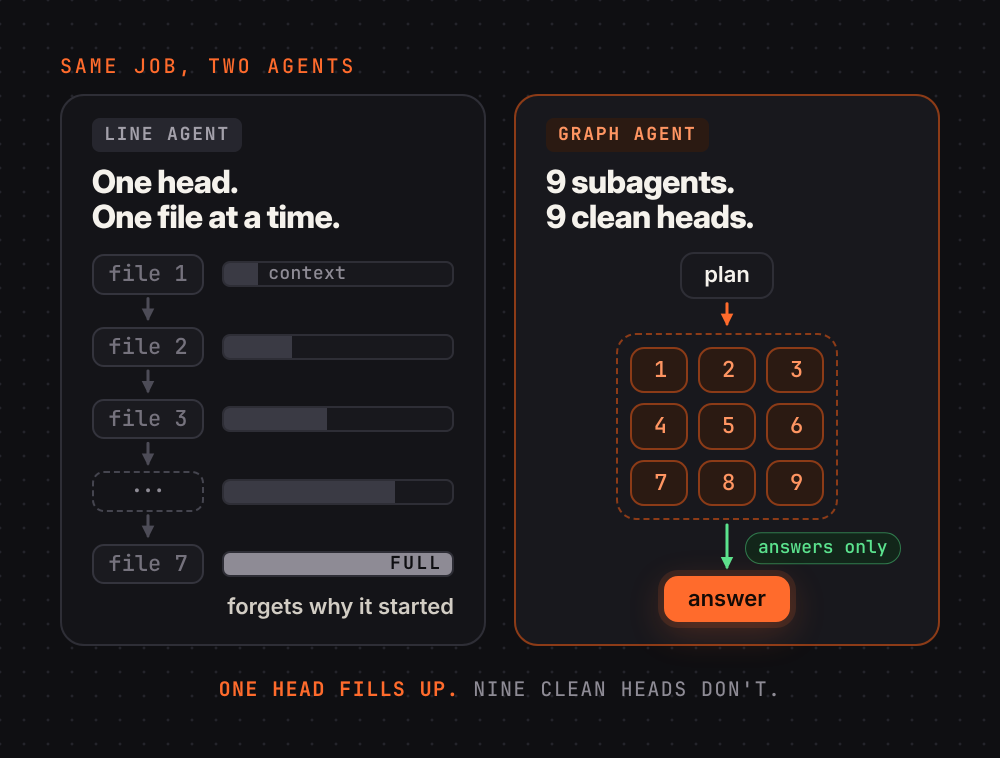

> I write about Claude Code in plain English. If you want the next breakdown in your feed, follow me here.

Claude Code can build the graph agent for you. The feature is called **dynamic workflows**.

You ask for a workflow. Claude writes a short script in plain JavaScript and runs it. The script starts a team of subagents.

Running the script itself costs zero tokens, because it's plain code. While it runs, you pay only for the subagents it starts.

You don't write this code yourself. Claude does. The code in this article shows what goes inside, so you know what to ask for.

Below are 14 differences between the two agents, most with code or a prompt. At the end: 6 jobs with prompts you can paste, and a cheat sheet you can save.

---

## 01. The line agent sees steps. The graph agent sees handoffs.

Every agent job is made of two things.

**Boxes.** Each box is a subagent with a single job. It takes something in and gives one answer back.

**Arrows.** An arrow is a handoff. It means the answer from this box goes into that box.

People call them nodes and edges. Boxes and arrows is enough.

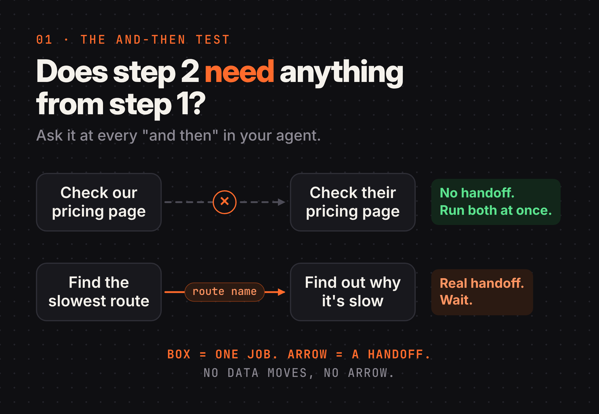

The line agent draws an arrow every time you write "and then".

"Check our pricing page and then check our competitor's pricing page."

There is no handoff here. The second check doesn't need anything from the first one. They can run at the same time.

Now compare: "Find the slowest API route and then find out why it's slow."

That one is real. You can't explain a slow route before you know which route it is.

So test every "and then" with one question:

**Does step 2 need anything from step 1?**

No? Then there's no arrow, and nobody should wait.

> In a workflow script, every agent() call is a box. If a prompt uses a variable that an earlier call returned, that's an arrow. If it uses nothing from earlier calls, that call can start right away.

---

## 02. The line agent keeps the order you typed. The graph agent keeps only real arrows.

"Do A, then B, then C, then D" is a graph too. It's the worst kind: one straight chain where each box waits for the one before it.

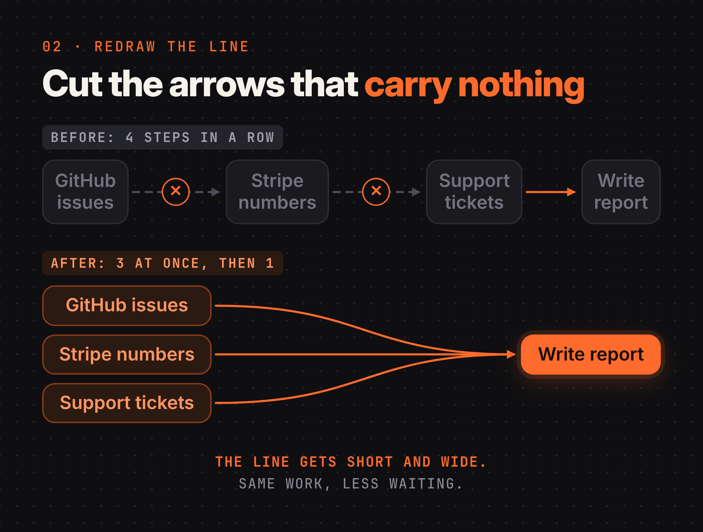

Take a weekly report agent:

1. Pull this week's GitHub issues
2. Pull the Stripe numbers
3. Pull the support tickets
4. Write the report

Go arrow by arrow. Does the Stripe step read the GitHub issues? No. Do the support tickets need the Stripe numbers? No.

Those two arrows carry nothing. Only your numbered list keeps the pulls in a line.

Drop those arrows, and the three pulls run side by side. The report waits only for them.

Most agents hide two or three of these. Five minutes with a pen will find them. Or ask Claude Code:

*"Which steps in my agent don't use the answer from the step before?"*

---

## 03. The line agent gets essays back. The graph agent gets a filled-in form.

If you can't predict what a box returns, running 20 of them at once just gets you 20 essays. Someone has to read all of them.

So every box needs a deal:

- **Input:** everything it needs, passed in directly. Never "it's somewhere above in the chat".
- **Output:** the same fields every time, so the next box knows where to look.
- **One job.** Not two.

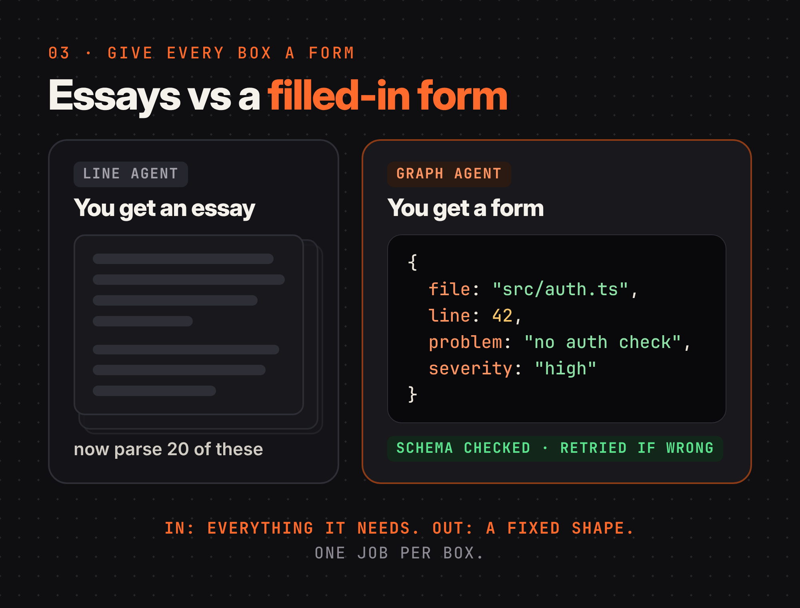

The form is a JSON schema. Pass one to agent(), and the subagent can only hand back an answer that fits it. If the shape is wrong, it has to try again.

So instead of "I found a few worrying patterns in the auth module...", you get file, line, problem, severity. Data your script can use.

Now every arrow carries something you can name, like "list of findings". That gives you two things:

- **Spotting a fake arrow.** If you can't name what's on it, cut it.
- **Swapping a box.** If the new box takes and gives the same shapes, nothing else has to change.

```javascript
const FINDINGS = {
  type: 'object',
  properties: {
    findings: {
      type: 'array',
      items: {
        type: 'object',
        properties: {
          file: { type: 'string' },
          line: { type: 'number' },
          problem: { type: 'string' },
          severity: { enum: ['low', 'high'] },
        },
        required: ['file', 'line', 'problem', 'severity'],
      },
    },
  },
  required: ['findings'],
}

const result = await agent(`Review ${file} for missing auth checks.`, {
  schema: FINDINGS,
})
// result.findings is a list you can loop over. No parsing.
```

---

## 04. The line agent pays Claude to glue. The graph agent glues with code.

Between "many subagents found stuff" and "one subagent writes the answer" there is usually glue: flatten the lists, drop the duplicates, drop the noise.

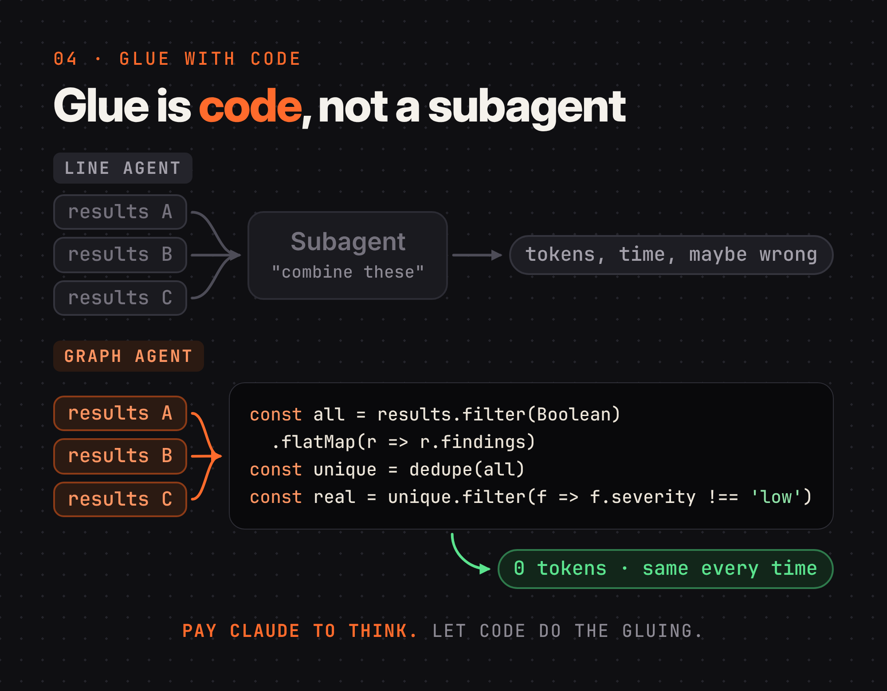

The line agent pays Claude to do this. In a graph it's a few lines of JavaScript: instant, the same result every time, zero tokens.

So don't start a subagent just to merge lists and drop duplicates. **Pay Claude to think. Let code do the gluing.**

```javascript
// The arrow between the finders and the final writer: plain code, no agent.
const all = results.filter(Boolean).flatMap(r => r.findings)
const seen = new Set()
const unique = all.filter(f => {
  const key = `${f.file}:${f.line}`
  if (seen.has(key)) return false
  seen.add(key)
  return true
})
const real = unique.filter(f => f.severity !== 'low')
```

---

## 05. The line agent reads 40 files one by one. The graph agent sends 40 subagents.

Say you have jobs that don't need each other: 40 files to review, 12 routes to check, 9 sources to read. The graph agent hands them all out at once. That's called a fan-out.

parallel() does it. You give it one small function per job. Each one starts a subagent, and you get back a list of answers.

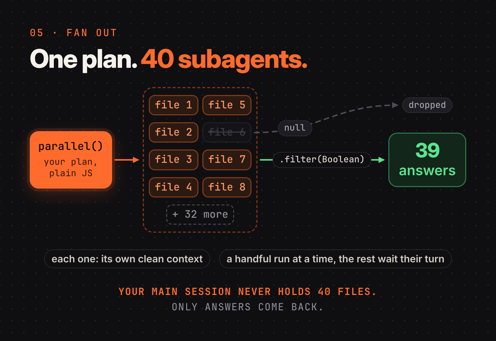

Two things to know:

- parallel() waits until every subagent is done, so the next step sees the full set.
- If one subagent crashes, its spot in the list becomes null. The other 39 still come back. Always add .filter(Boolean).

You can hand it 100 jobs. Only a handful run at the same moment (it depends on your machine). The rest wait their turn and still finish.

This also fixes the line agent's file 7 problem. Your main Claude only ever sees the answers.

```javascript
const results = await parallel(
  files.map(file => () =>
    agent(`Review ${file} for missing auth checks.`, { schema: FINDINGS })
  )
)
const answers = results.filter(Boolean) // drop the ones that crashed
```

---

## 06. The line agent waits after every step. The graph agent waits only when it has to.

All the answers from a fan-out end up in one place. That place can be a subagent or a few lines of code.

Waiting for all of them is a wall: nothing moves on until the last answer is in. Walls cost time, so put one up only when the next step needs all the answers side by side:

- removing duplicates across all sources
- stopping early because nothing was found at all
- a prompt that says "compare this with the other findings"

Don't wait just to flatten a list or clean up each item. Do that on the way.

Quick test. Say your script goes parallel, then a small cleanup, then parallel again. If that cleanup never compares items with each other, the wall in the middle is wasted. Use pipeline() instead (more on that in 13).

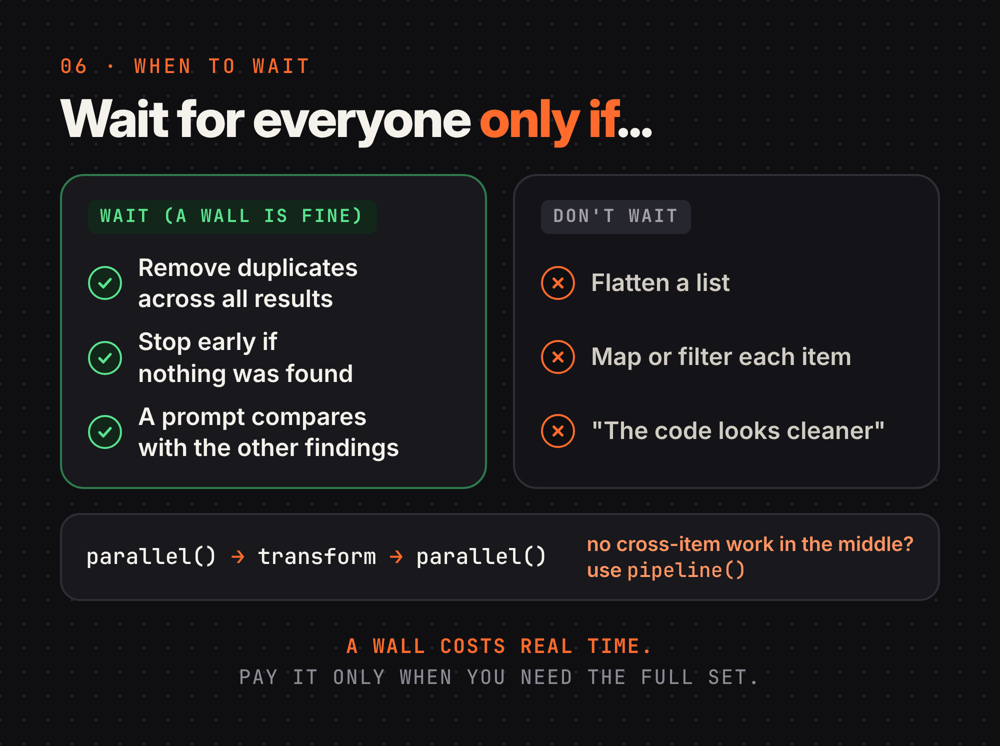

```javascript
// A wall that is worth it: stop before you pay for verification
const all = (await parallel(finders)).filter(Boolean).flatMap(r => r.findings)
if (all.length === 0) return 'Nothing found. Skipping verification.'
```

---

## 07. The line agent adds more steps. The graph agent draws a diamond.

Draw a fan-out and the place where its answers end up, and you get a diamond.

First the job gets split. Then many boxes work at once. Then one box merges what they found.

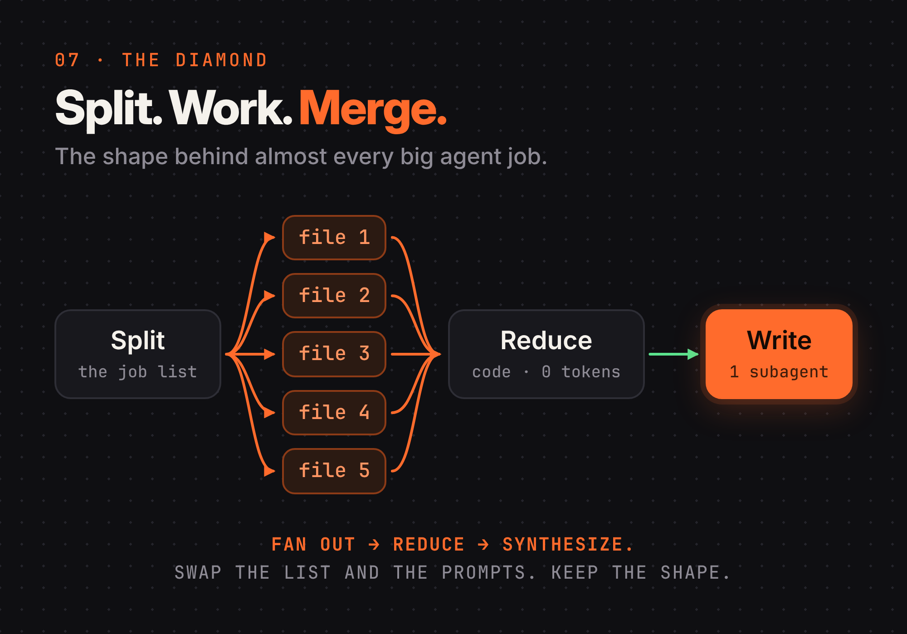

A code review, a dependency audit, a competitor scan and a research report all look like this. Only the list and the prompts change.

Its name is **fan out → reduce → synthesize.**

- **Fan out** to cover a lot of ground.
- **Reduce** the pile with a few lines of code.
- **Synthesize** the answer with one last subagent.

The line agent asks "what's the next step?"

The graph agent asks "where does the work split, and where does it meet again?" That question works for 5 files and for 500.

> Halfway. If this is already useful, follow me now. Below: 7 more differences, 6 prompts you can paste and the cheat sheet.

---

## 08. The line agent decides on a whim. The graph agent decides in code.

Some graphs have a fork. Which way the work goes depends on what a box found.

Is this ticket a bug or a feature request? Each kind goes to its own handler. Is this diff a typo fix or a change to the login code? Small and safe gets a quick look. Big or risky gets the full audit.

In the script, the fork is an if or a switch. The schema makes sure the subagent answers with one of the options you expect.

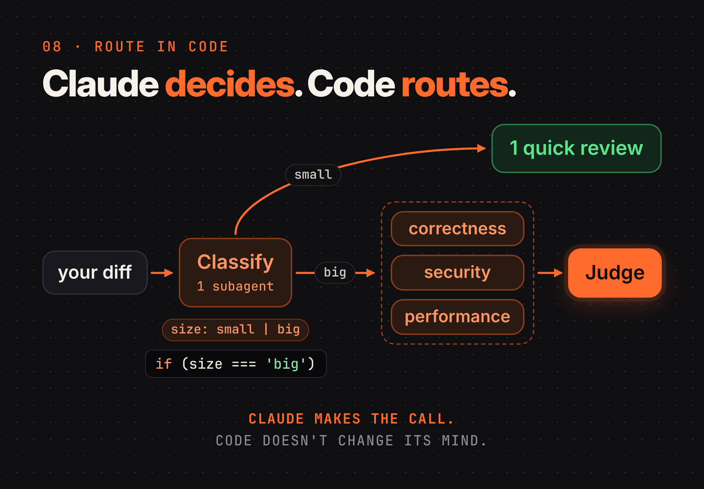

Here, boring code is exactly what you want.

Claude makes the call inside the box. Everything after the call is code, and code doesn't change its mind.

The line agent can skip the audit one day and run it the next. In a graph, a skip only happens if the script says so.

```javascript
const question = `Is this diff small and safe?
Answer small only if it is both. Otherwise answer big.
${diff}`
const { size } = await agent(question, {
  schema: {
    type: 'object',
    properties: { size: { enum: ['small', 'big'] } },
    required: ['size'],
  },
})

let review
if (size === 'big') {
  const reviews = await parallel(
    ['correctness', 'security', 'performance'].map(lens => () =>
      agent(`Review this diff for ${lens} problems only.\n${diff}`)
    )
  )
  const all = JSON.stringify(reviews.filter(Boolean))
  review = await agent(`You are the judge. Merge these into one review:\n${all}`)
} else {
  review = await agent(`Do a quick review of this diff.\n${diff}`)
}
```

---

## 09. The line agent trusts its first answer. The graph agent tries to kill it.

The line agent writes down a finding and moves on. Nobody checks it.

The graph agent puts a checker on the arrow, just before the final answer, and tells it to prove each finding wrong. Only the findings it can't break go through.

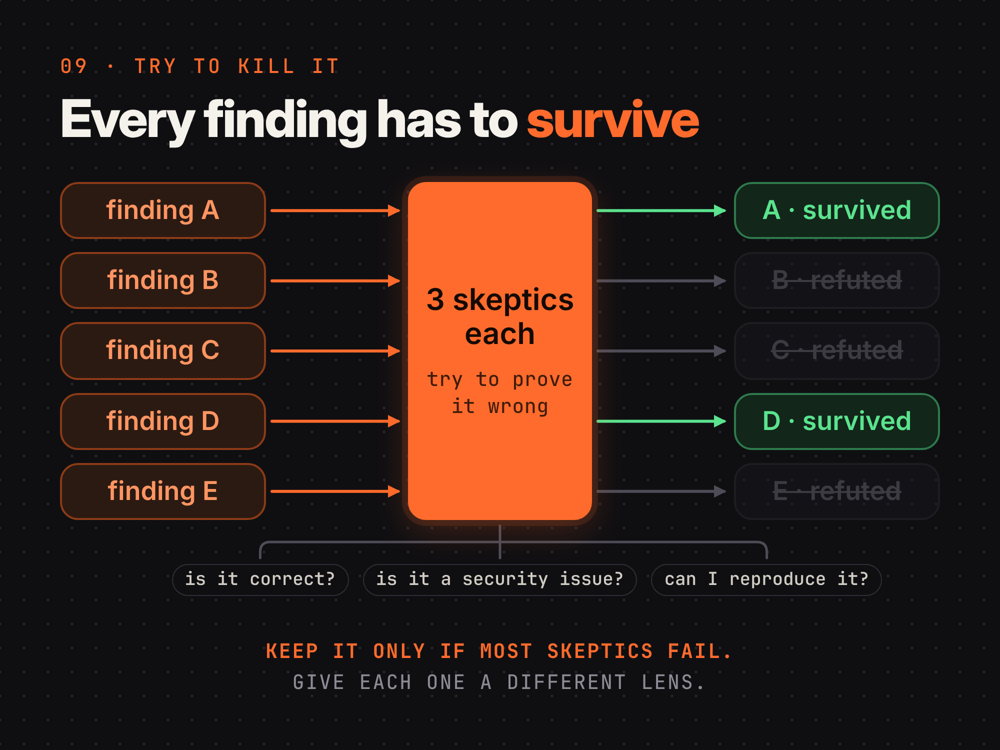

Three ways to add checks:

- **Skeptics.** For every finding, start 3 subagents and tell each one to prove it wrong. Keep the finding only if most of them fail.
- **Different lenses.** Give each checker its own question: is it correct? is it a security issue? can I reproduce it? Three different checks catch more than three copies of the same check.
- **Judges.** Make 3 attempts from different angles and let judges score them. Build on the winner and borrow the best parts of the other two.

A team ported the Bun runtime with checks like these in the loop.

```javascript
// VERDICT is a schema like FINDINGS, with two fields:
// refuted (true or false) and why (text)
const votes = await parallel([1, 2, 3].map(() => () =>
  agent(`Try to prove this finding wrong: ${JSON.stringify(finding)}
If you are not sure, say it is wrong.`, { schema: VERDICT })
))
const survives = votes.filter(Boolean).filter(v => !v.refuted).length >= 2
```

---

## 10. In a line, one crash kills the run. In a graph, it's one empty chair.

That empty chair is the null from 05. Your .filter(Boolean) clears it away, and the rest of the run goes on.

So write every merge step to expect empty chairs.

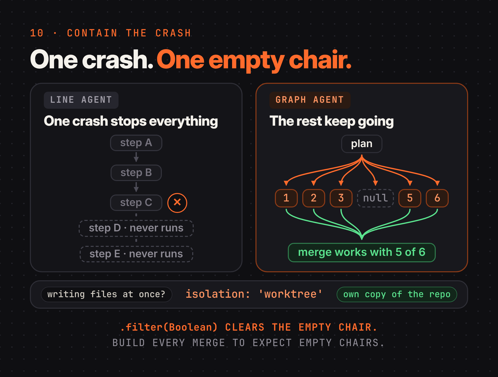

The other problem is shared files. If 5 subagents edit files at the same time, they can overwrite each other's work.

Give each one **isolation: 'worktree'**. It gets its own git worktree, basically a private copy of the repo, so nobody touches anybody else's files.

Skip it unless subagents write files at the same time. Every worktree costs setup time and disk space. A line agent never needs this at all: it only touches one file at a time.

```javascript
await parallel(files.map(file => () =>
  agent(`Port ${file} to TypeScript and make its tests pass.`, {
    isolation: 'worktree',
  })
))
```

---

## 11. The line agent stops at a number. The graph agent stops when nothing new turns up.

A bug hunt has no fixed size. Each bug you find can lead to three more.

The line agent handles this with a number: "find 10 bugs". It finds 10 and stops, even if there are 30.

The graph agent uses a loop: an arrow back to an earlier box. A loop with no exit keeps starting subagents and spending your money.

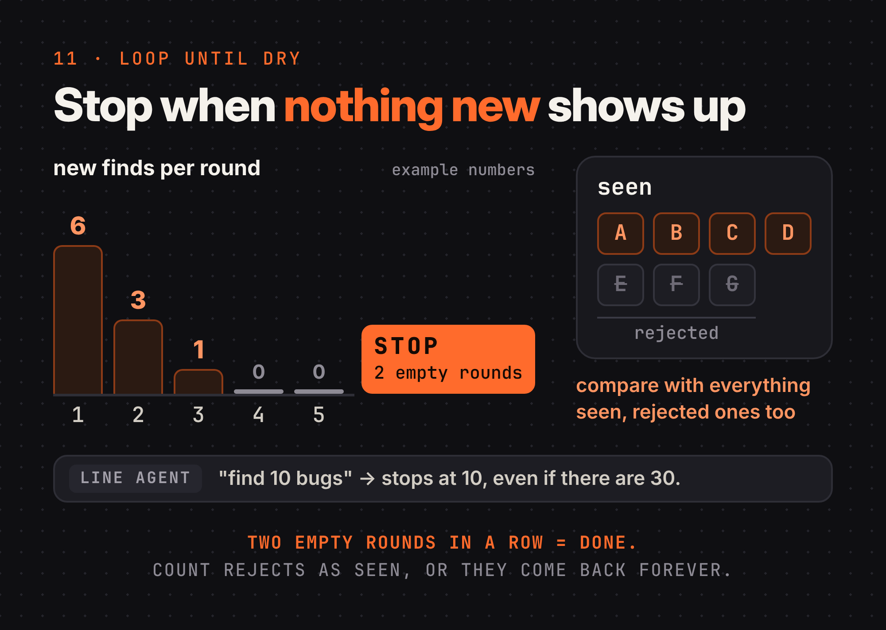

The loop that ends is called **loop until dry**. Keep sending finders. When 2 rounds in a row find nothing new, stop.

The tricky part is what you compare new finds against.

Compare against **everything you've seen**, including the finds you threw out. If you don't, the rejects come back every round looking new, and the loop never ends.

Want a hard limit too? Put a token budget like +500k in your prompt. The script can check how much is left. Once it's spent, no new subagents start.

```javascript
const seen = new Set()
const confirmed = []
let dryRounds = 0

while (dryRounds < 2) {
  const found = (await parallel(finders)).filter(Boolean).flatMap(r => r.bugs)
  const fresh = found.filter(b => {
    if (seen.has(key(b))) return false // compare with EVERYTHING seen
    seen.add(key(b))
    return true
  })
  if (fresh.length === 0) { dryRounds++; continue }
  dryRounds = 0
  confirmed.push(...(await verifyAll(fresh)))
}
```

---

## 12. The line agent pays top price for every step. The graph agent pays for judgment.

Some boxes are chores: pull one field out of a file, tag a ticket, check a link. Some boxes hold the real judgment: write the final report, decide if a finding is real.

The line agent can't make this split. Every step runs on the same model.

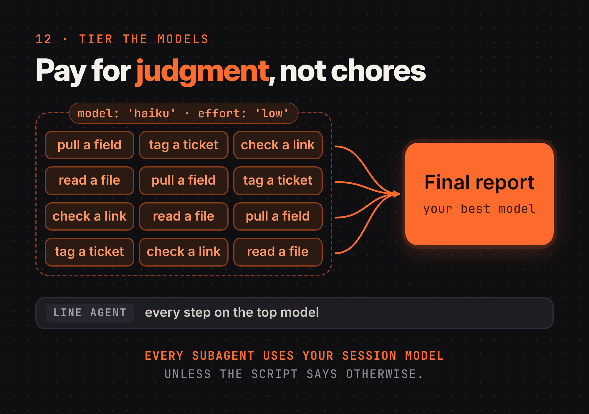

In a workflow, every subagent runs on your session model by default. If that's your top model, a run with 40 subagents pays top price 40 times.

Two options on agent() fix it. **model** sends just that subagent to a different model. **effort: 'low'** tells it not to overthink a simple job.

Before a big run, check /model. Then tell Claude: a cheaper model for the many small boxes, your best model for the merge.

```javascript
// chores: cheap and fast
const facts = await parallel(files.map(file => () =>
  agent(`List the exported functions in ${file}.`, {
    model: 'haiku',
    effort: 'low',
    schema: NAMES,
  })
))

// judgment: no override, so it runs on your session model
const list = JSON.stringify(facts.filter(Boolean))
const report = await agent(`Write a short overview of our public API from:\n${list}`)
```

---

## 13. The line agent's time is the sum of its steps. The graph agent's time is its slowest path.

Take the weekly report from 02. The line agent's time is pull + pull + pull + report. The graph agent's time is the slowest pull + report.

Inside a graph, one more choice changes the time a lot: parallel() or pipeline().

Run each stage with parallel(), and there's a wall after every stage. Nobody moves on until the slowest item is done.

pipeline() has no wall. Each item moves through the stages on its own, so a fast one can finish every stage while a slow one is still on the first.

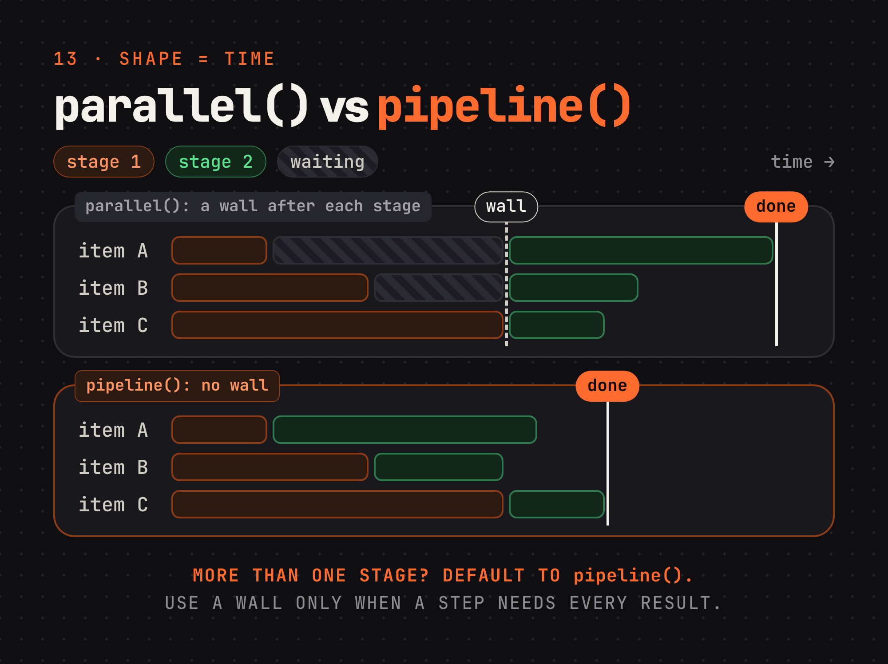

**So when the work has more than one stage, default to pipeline().**

Put up a wall only for the three cases in 06.

"The code looks cleaner" and "the stages feel separate" don't count. A wall you don't need is the line agent coming back: waiting for no reason.

```javascript
// each file goes find → verify on its own. no wall between the stages.
const verified = await pipeline(
  files,
  file => agent(`Find missing auth checks in ${file}.`, { schema: FINDINGS }),
  found => found.findings.length === 0
    ? null // nothing found in this file? no verifier
    : agent(`Try to prove these wrong:\n${JSON.stringify(found)}`, { schema: VERDICTS })
)
```

---

## 14. You draw the line agent. Claude draws the graph.

You don't have to plan the graph yourself either. Describe the goal. Claude decides where the work splits and where it merges, and writes a new script for this one run.

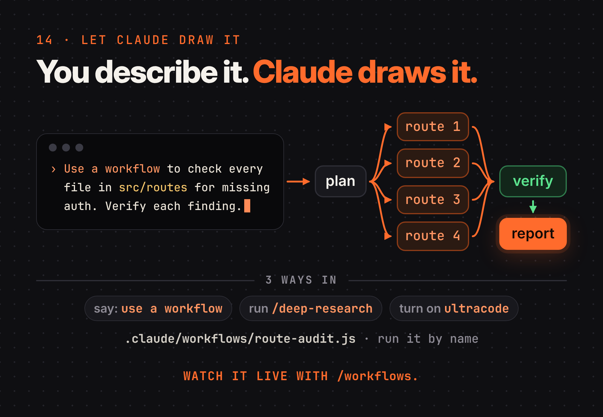

Three ways in:

- **Ask for it.** Put "use a workflow" in your prompt.
- **Run a ready-made one.** /deep-research comes with Claude Code: scope → parallel search → fetch → try to disprove → write. That's a diamond with skeptics on the arrows.
- **Turn on ultracode.** Put the word "ultracode" in your prompt. Then Claude plans a workflow for every big task.

Want to watch it work? /workflows shows the run live, subagent by subagent.

After a good run, press s to save its script into .claude/workflows/. Commit it, and anyone who clones the repo can run it by name.

```
› Use a workflow to check every file in src/routes for missing auth checks.
  One subagent per file. Then 3 skeptics try to prove each finding wrong.
  Report only what survives, sorted by severity.
```

---

## 6 jobs to give a graph agent this week

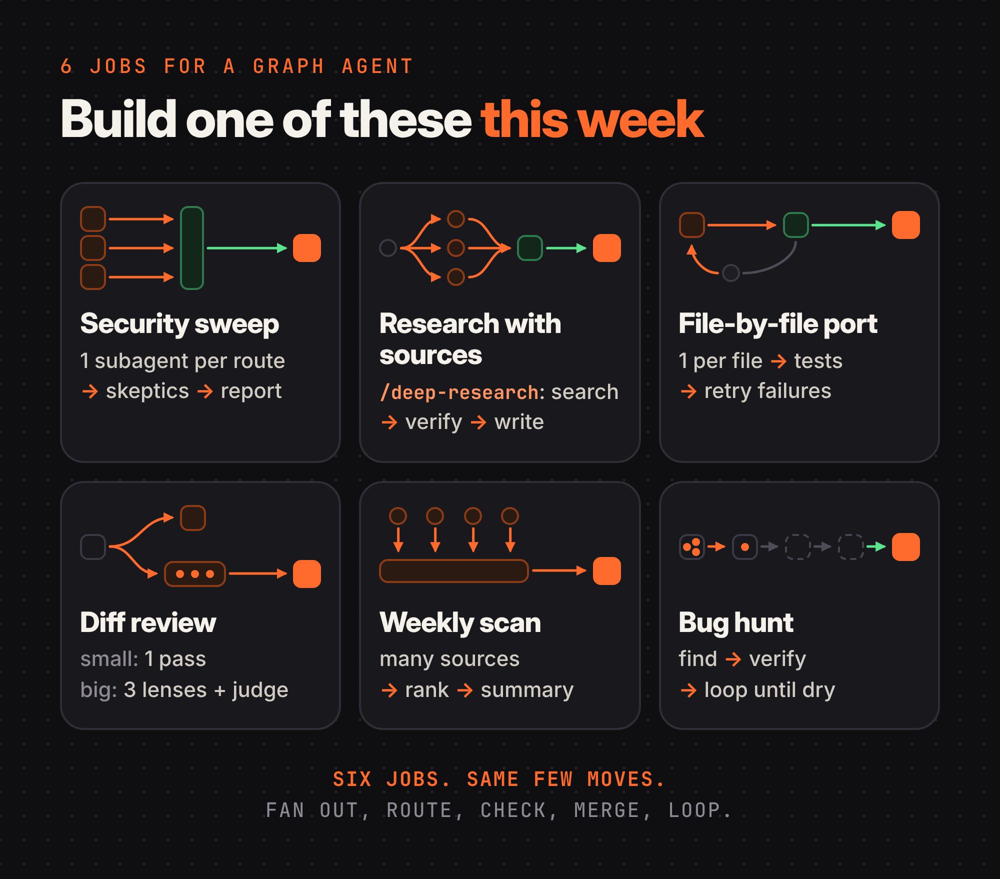

**1. Security sweep.** A line agent can run out of room halfway through your routes. Here, every route file gets a clean head.

*Prompt: "Use a workflow. One subagent per file in src/routes, each one looking for missing auth checks and unchecked input. Then 3 skeptics per finding. Report only what survives, worst first."*

**2. Research with sources.** Ask one question, and /deep-research runs the whole diamond for you. Three skeptics vote on every claim before it goes in the report.

*Prompt: "/deep-research what changed in [your topic] in the last 6 months"*

**3. Port a module to TypeScript.** Every file gets its own subagent and its own worktree, so nobody overwrites anybody. A file is done only when its tests pass.

*Prompt: "Use a workflow to port src/legacy to TypeScript. One subagent per file, each in its own worktree. Run the tests after each file and send failures back, up to 3 tries per file. List the files that still fail."*

**4. Diff review that grows with the diff.** A line agent gives a typo fix and a rewrite of your login code the same review. This one sizes up the diff first.

*Prompt: "Use a workflow to review my current diff. If it's small, one quick pass. If it's big, three reviewers with different focus and one judge."*

**5. Weekly scan.** Release notes, blogs and forums get read at the same time, and the merge ranks the changes by impact. Save it, and next week it's one command.

*Prompt: "Use a workflow to check the release notes, blogs and forums of [the tools I use] and give me this week's changes, ranked by impact."*

**6. Bug hunt of unknown size.** The line agent stops at 10 bugs. This one stops when the bugs stop, and it never pays twice for the same rejected find.

*Prompt: "Use a workflow to find bugs in src/payments. Verify each one. Count rejected finds as seen too, so they don't come back. Keep going until two rounds in a row find nothing new."*

---

## The two agents, one last time

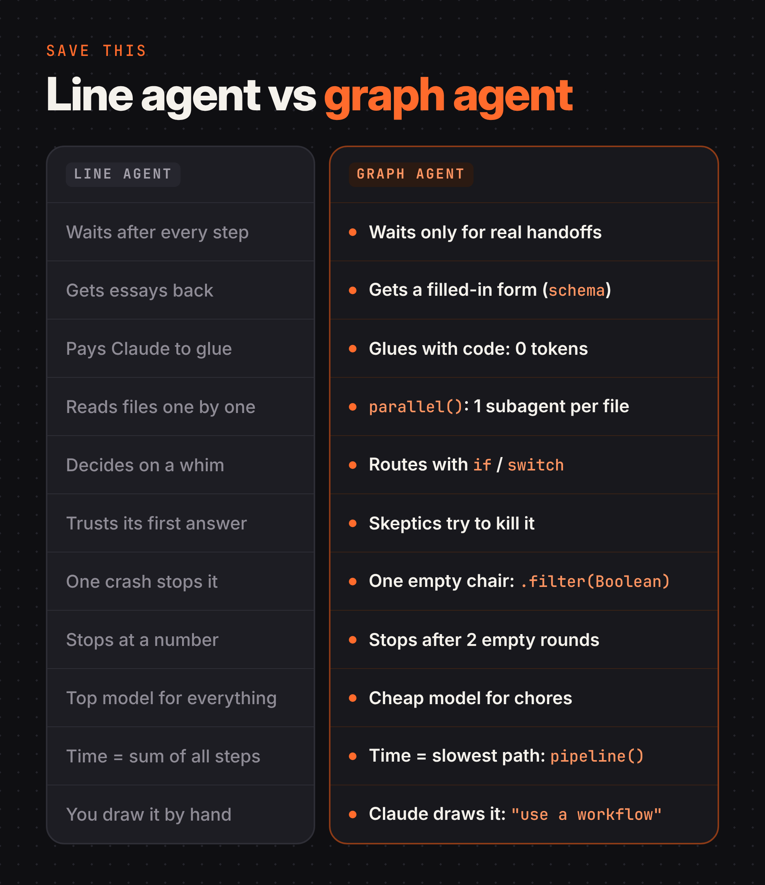

The line agent is one head doing one thing at a time. It waits for no reason, pays tokens for glue, trusts its first answer, and stops when it runs out of room.

The graph agent splits the work, runs it at once, checks itself, and hands you one clean answer.

Same Claude. Same prompt box. Different shape.

We build lines because we type in lines. A prompt is one sentence after another, so the first agent we build looks the same.

This week, take one agent you already have and cut one arrow that carries nothing.

Bookmark this, or save the cheat sheet above. You'll want it the next time you write "and then".

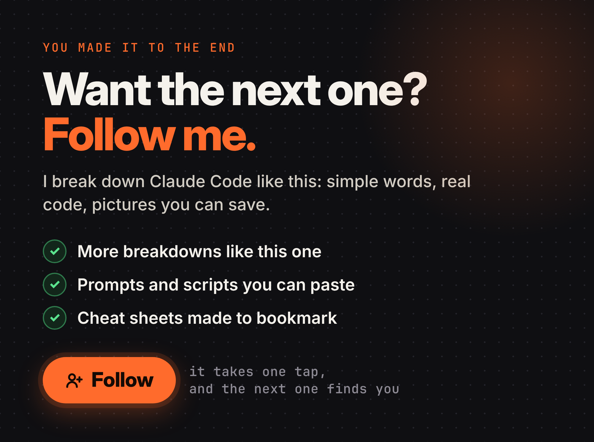

> If this was useful, follow me here for the next breakdown. You can also get them by email on my Substack: movez.substack.com
